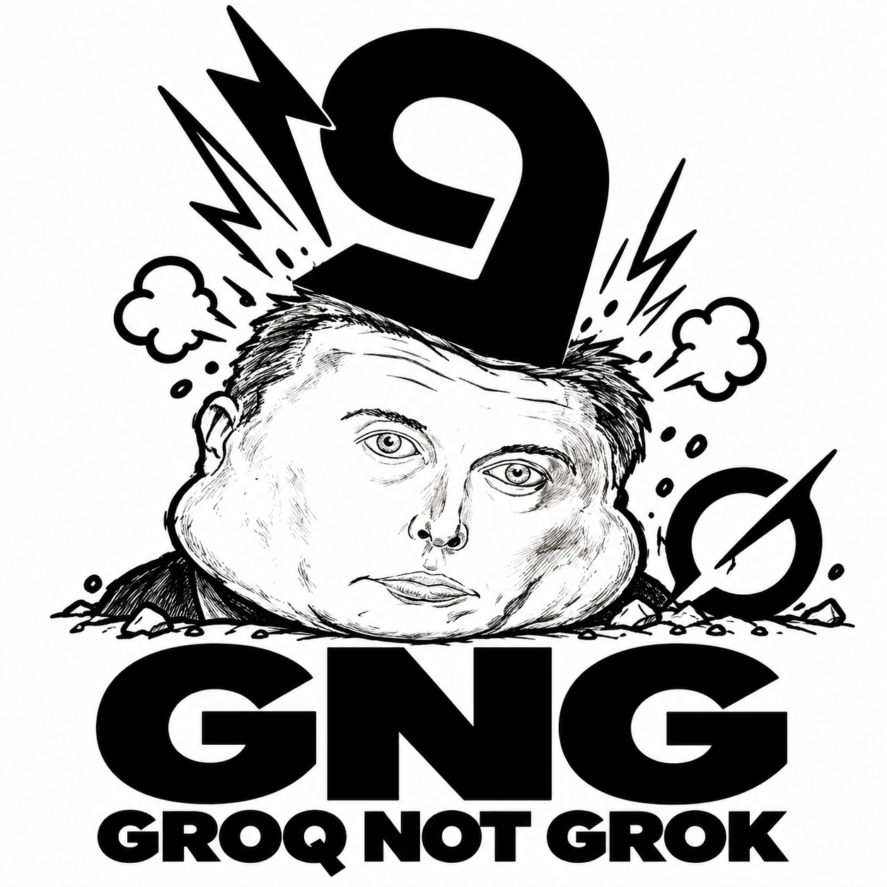

# Groq Not Grok

<p align="center">
  
</p>

Use Groq chat completions, image input, and browser-backed web search from Python or the shell. Requires Python 3.11 or later. Runtime dependencies: none.

## Requirements

- Python 3.11 or newer.
- A Groq API key in `GROQ_API_KEY` or `GROQ_KEY`.
- Chrome, Chromium, or Brave for browser search and page extraction. Google News RSS is used when Chrome is unavailable or Google presents a challenge.

The package uses only Python's standard library at runtime. `hatchling` is needed to build a wheel.

## Install

```sh
python -m venv .venv
source .venv/bin/activate
python -m pip install -e .
```

On Windows, activate `.venv\\Scripts\\activate` instead.

## CLI

`gng` and `groq-not-grok` start the same prompt. It has a black `🤖` banner, coloured input, plain answers, and a model picker. Set `NO_COLOR=1` or pass `--no-color` to disable colour.

```sh
gng                              # interactive REPL
gng "explain this error"         # one-shot
gng -p "explain this error"      # same as the positional form
gng -m openai/gpt-oss-20b "hi"   # choose a model
gng --models                     # free Groq models, offline fallback
gng --models-all                 # every available Groq model
gng --web "news of the day"      # search before replying
gng --image shot.png "describe"  # local image or HTTPS URL
```

Commands:

- `/models` opens the free-model picker; `/models-all` shows the full catalog.
- `/model [N|id]` opens the free picker, or switches directly.
- `/status` shows model, vision model, web and history state.
- `/web [on|off]` toggles browser-backed web search; **Ctrl+W** does the same.
- `/history [on|off]`, `/image PATH [text]`, `/read FILE`, `/clear`, `/help`, `/quit`.

The session keeps multi-turn history by default. Aliases are `oss120` (default), `oss` (`gpt-oss-20b`), `qwen`/`vision`, and `allam`. Groq has no separate premium tier, so `/models` and `/models-all` show the same catalog.

## Use

```python
from gng import AIGenerator

ai = AIGenerator()
try:
    print(ai.generate("Explain this result", with_web=True))
    print(ai.ask_image("Describe the image", "https://example.com/image.jpg"))
finally:
    ai.close()
```

The default chat model is `openai/gpt-oss-120b`; image requests use `qwen/qwen3.8-27b` and return JSON. Set `GROQ_MODEL` or `GROQ_VISION_MODEL` to override either default. `GROQ_BASE_URL` changes the API endpoint.

## Browser settings

Set `GROQ_NOT_GROK_CHROME` when the browser executable is outside a standard location. `GROQ_NOT_GROK_CDP_PORT`, `GROQ_NOT_GROK_CDP_HOST`, and `GROQ_NOT_GROK_CHROME_PROFILE` configure the local DevTools connection and browser profile. `Web.google_search()` visits Google in the browser; `Web.google_image_search()` extracts image URLs and source pages from the rendered Google Images DOM with JavaScript; `Web.visit_page()` extracts visible content from a URL. Text search falls back to Google News RSS when the browser is unavailable or search is challenged.

## Tests

```sh
PYTHONPATH=src python -m unittest discover -s tests -v
```

## License

MIT. See [LICENSE](LICENSE).
